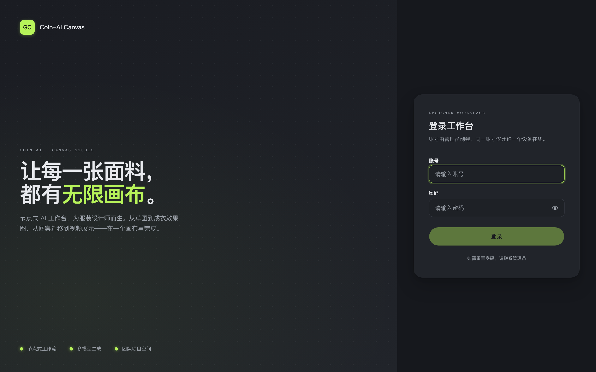
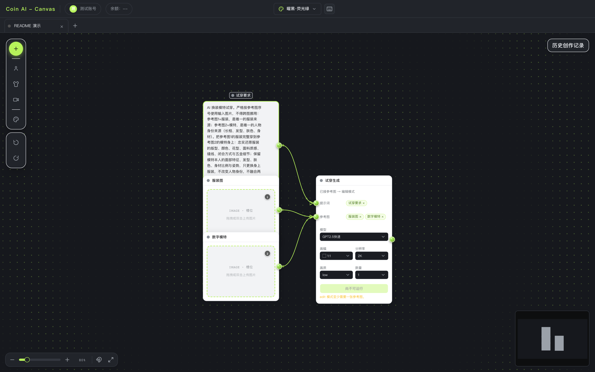
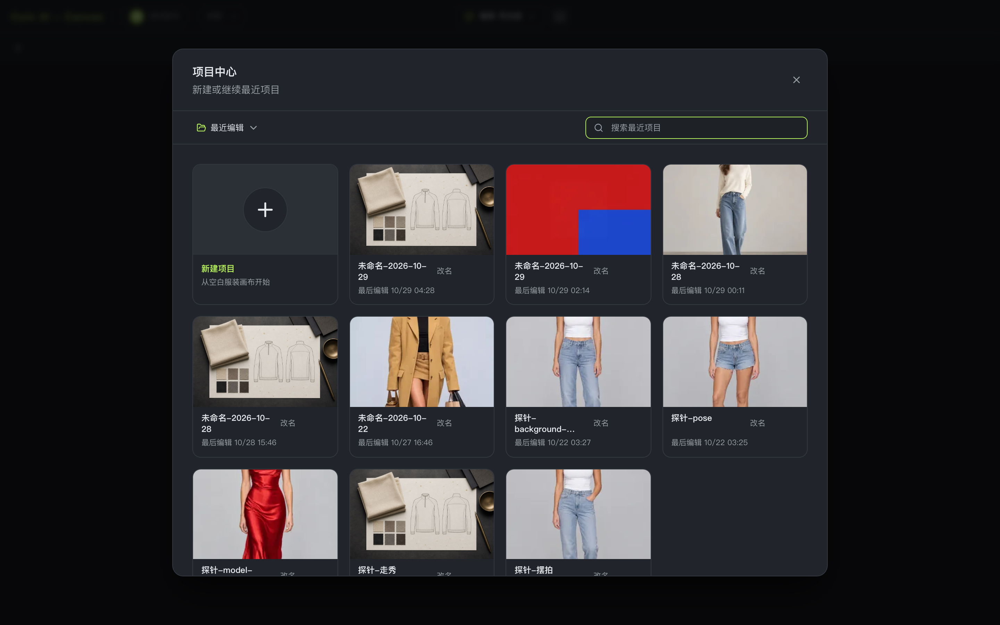

# Coin-AI Canvas

面向服装设计的 AI 画布工作台：把「参考图 → 提示词 → 生成 → 局部修改 → 结果沉淀」做成一张可连线的画布，而不是一堆零散的生成入口。



## 它能做什么

| 能力 | 说明 |
|---|---|
| **模板建图** | 15 个内置模板（模特试穿、摆拍、数字模特、印花提取、面料替换、线稿渲染、走秀视频等），选中即得到一条连好的工作流 |
| **节点画布** | 图片 / 文本 / 生成 / 结果四类节点自由连线；参考图按「图1、图2」序号绑定角色，跑图时序号与徽标一致 |
| **多模型** | 9 个图像模型（GPT Image 2.5 快/专、Gemini 香蕉 3.1/2.1、Seedream 5.0 快/专、Qwen 3.0 快/专、FLUX 3）+ 3 个视频模型，按能力自行切换 |
| **局部修改** | 蒙版重绘（涂抹区域重画）与多轮修改（在结果上继续改），产物原地替换、可撤销 |
| **上传即标准化** | EXIF 校正、转 sRGB、体积收敛；用户主动上传的图默认进素材库「未分类」 |
| **结果与历史** | 每次运行有唯一生成 ID；失败卡片直接显示失败原因；管理员可查看全部历史 |
| **三主题** | 曜黑·荧光绿 / 简白 / 护眼绿，1024–1440 桌面宽度 |





## 快速开始

要求 Node.js 24.20.0 或更高版本，以及本机原生 PostgreSQL 18。Node.js 24.20.0 是 `.nvmrc` 固定的最低
可复现基线；门禁接受 24.20.0 及更高兼容版本（有 nvm 时可先 `nvm use`）。

```bash
git clone https://github.com/zzzfan008-rgb/kittin-saas-b-v2.git
cd kittin-saas-b-v2
npm ci
cp .env.example .env      # 填入 GATEWAY_API_KEY 与数据库密码
npm run dev               # http://localhost:5173
```

`.env` 至少需要这些键：

```ini
GATEWAY_BASE_URL=https://api.ourzhishi.top
GATEWAY_API_KEY=<你的网关密钥>
POSTGRES_DB=coin_ai_canvas
POSTGRES_USER=coin_ai_canvas
POSTGRES_PASSWORD=<长随机密码>
POSTGRES_HOST_PORT=5432
```

首次建库（开发库 + 测试库，测试库名必须以 `_test` 结尾）：

```bash
psql -d postgres -c "CREATE ROLE coin_ai_canvas LOGIN PASSWORD '<同上>';"
psql -d postgres -c "CREATE DATABASE coin_ai_canvas OWNER coin_ai_canvas;"
psql -d postgres -c "CREATE DATABASE coin_ai_canvas_test OWNER coin_ai_canvas;"
```

`npm run dev` 会先跑 `dev:check`：核对 Node 版本、5173/后端端口占用、PostgreSQL 连通性
（只读 `SELECT 1`），以及 Vite 代理目标。预检不会停进程、改数据库或调用 AI。

## 常用命令

```bash
npm run dev                  # 开发（含环境预检）
npm test                     # 单元/契约测试（需隔离 PostgreSQL）
npm run test:e2e             # Playwright 端到端（三宽度矩阵）
npm run docs:gateway:check   # 模型契约结构门（离线，CI 必跑）
npm run gen:presets:check    # 提示词镜像一致性
npm run build && npm start   # 生产构建与启动
```

## 技术栈

| 层 | 选型 |
|---|---|
| 前端 | React 18 + TypeScript + Vite + React Flow（画布）+ Tailwind/shadcn |
| 后端 | Node + Express + PostgreSQL 18（原生 pg，15 张表）|
| 存储 | 本地文件系统（上传/生成产物，按 owner ACL 隔离）|
| 模型接入 | 统一 gateway provider 层：9 图像 + 3 视频，每家独立参数契约（`docs/ai/gateway`）|
| 质量门 | tsc · 114 单测 · Playwright e2e · dependency-cruiser 分层 · ast-grep 规则 |

## 目录

```
src/               前端（节点、面板、store、主题）
server/            后端（路由、provider、执行引擎、数据库）
e2e/               Playwright 端到端
tests/             单元与契约测试
docs/ai/gateway/   模型契约（运行时来源，含 9 图像 + 3 视频 hash 锁定）
docs/design/       仍被代码引用的设计契约（历史设计稿已清理）
deploy/            systemd / launchd 部署单元
scripts/           构建、门禁、镜像生成等工具链
```

## 生产部署

Docker（可选）：

```bash
docker compose up -d --build --wait
```

非 Docker：

```bash
npm ci --omit=dev
npm run build
npm start
```

首次启动前必须在私有 `.env` 配置管理员临时凭据（首次登录强制改密）：

```ini
INITIAL_ADMIN_ACCOUNT_ID=your-admin-account
INITIAL_ADMIN_PASSWORD=your-temporary-password
```

完整的环境变量、备份恢复、SQLite 迁移、故障处理与安全基线见
[`docs/DEPLOYMENT_AND_OPERATIONS.md`](docs/DEPLOYMENT_AND_OPERATIONS.md)。

运行状态接口：`GET /api/health`（进程存活）、`GET /api/ready`（数据库/数据目录/AI 配置/前端产物）。

## 文档

| 文档 | 内容 |
|---|---|
| [`AGENTS.md`](AGENTS.md) | 项目硬规则、UI 边界、验证流程、发布门禁（**唯一规则源**）|
| [`docs/DEPLOYMENT_AND_OPERATIONS.md`](docs/DEPLOYMENT_AND_OPERATIONS.md) | 生产部署、常驻运行、环境变量、管理员初始化、备份恢复 |
| [`docs/RELEASE_CHECKLIST.md`](docs/RELEASE_CHECKLIST.md) | 发布前检查清单 |
| [`docs/ai/gateway/README.md`](docs/ai/gateway/README.md) | 模型契约与端点实测证据 |
| [`docs/PHASE_D_VISUAL_ACCEPTANCE.md`](docs/PHASE_D_VISUAL_ACCEPTANCE.md) | 三主题桌面视觉验收证据 |

## 许可

内部项目，未公开授权。
